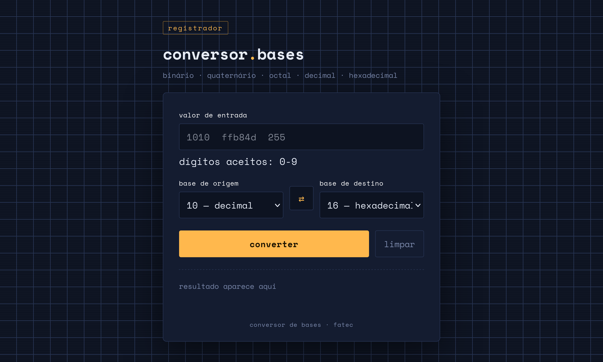

# Alquimia Numérica ⚗️

[](LICENSE)

> 1st academic project. Systems Analysis and Development (ADS), **FATEC**

Number base converter. Vanilla HTML, CSS, JS. Exact math. Responsive

🔗 **Live:** [base-conversor.vercel.app](https://base-conversor.vercel.app/)

<p align="center">
  
</p>

---

## What it do

Convert numbers between 5 bases:

- Binary (2)
- Quaternary (4)
- Octal (8)
- Decimal (10)
- Hexadecimal (16)

---

## How it work

### Own algorithms, no native convert

Course rule: no `parseInt(string, radix)`, no `number.toString(radix)`. All logic hand-made

- **`toDecimal`:** loop over input string. Each char → number via index in `0123456789ABCDEF`. Multiply total by source base, add digit. Repeat
- **`fromDecimal`:** divide by target base, keep remainder (`%`), repeat till quotient zero. Map remainders to chars, reverse! Done

### `BigInt` for big number

JS `Number` = IEEE 754 double. Exact integers stop at 2^53 − 1 (`Number.MAX_SAFE_INTEGER`). Above that, rounding errors. Long binary and hex hit this fast

Fix: all inner math use `BigInt` (`0n`, `BigInt(base)`). No size limit except RAM. Precision stay exact

---

## Features

- Convert to one base or **all 5 at once**
- Live input validation: only digits valid for source base
- Swap button: flip source and target
- Copy result to clipboard, manual fallback for old browsers
- Positive and negative integers

---

## Structure

```text
.
├── index.html
├── style.css
├── script.js
├── README.md
├── assets/
│   └── favicon.png
└── docs/
    └── preview_base_conversor.png
```

---

## Run

Easy way: open [base-conversor.vercel.app](https://base-conversor.vercel.app/)

Local:

1. Clone:
   ```bash
   git clone https://github.com/upaulo/alquimia-numerica.git
   ```
2. Open `index.html` in browser

---
